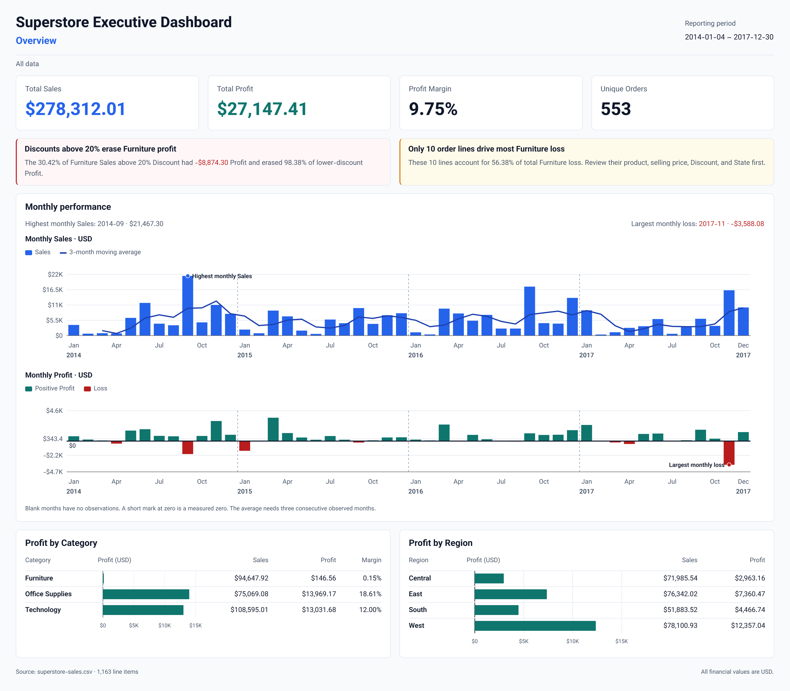

# Superstore BI Dashboard

**Inspect sales. Find losses. Compare performance.**

Built for an **AI Agent Bootcamp assignment**, this project connects CSV analysis, a FastAPI backend, and an interactive dashboard in English and Persian.

**Next.js · TypeScript · Tailwind CSS · FastAPI · pandas · Recharts**



[Product report](reports/en/02-products.png) · [Profitability report](reports/en/03-profitability.png) · [Geography report](reports/en/04-geography.png) · [Analysis notebook](analysis.ipynb)

## What you can do

| View | Purpose |
| --- | --- |
| **Overview** | Inspect sales, profit, margin, orders, and monthly trends. |
| **Products** | Compare 17 subcategories and find products with losses. |
| **Profitability** | Compare furniture profit by discount band, subcategory, and state. |
| **Geography** | Inspect the US profit map and compare state sales with profit. |

- Filter by date, year, region, segment, category, subcategory, and state.
- Switch between English and Persian.
- Export all four views as PNG reports with the applied filters and selected language.

## One finding from the data

Furniture has **$94,647.92 in sales**, but only **$146.56 in profit**: a **0.15% margin**. The Profitability view shows how profit differs across discount bands and products.

The included dataset has **1,163 order line items** and **553 distinct orders**, from **2014 to 2017**. These values describe this CSV.

## How it works

```text
Superstore CSV → pandas validation and analysis → FastAPI → Next.js dashboard → PNG reports
```

The backend calculates dashboard values from the same filtered data. It checks CSV columns, values, and dates at startup. The frontend distinguishes missing monthly observations from measured zero values. Backend tests check totals, filters, and profit calculations. Frontend tests check monthly calculations and data requests.

## Run locally

Use **Python 3.11**, **Node.js 24**, and **npm**. Run these commands in PowerShell from the project root.

**1. Start the backend.**

```powershell
python -m venv .venv
.\.venv\Scripts\python.exe -m pip install -r backend\requirements-dev.txt
.\.venv\Scripts\python.exe -m uvicorn backend.app.main:app --reload --host 127.0.0.1 --port 8000
```

**2. Start the frontend in a second terminal.**

```powershell
cd frontend
npm ci
npm run build
npm run start -- --port 3000
```

Open the [dashboard](http://127.0.0.1:3000) or the [API documentation](http://127.0.0.1:8000/docs).

## Check the project

Run backend tests from the project root:

```powershell
.\.venv\Scripts\python.exe -m pytest backend\tests -q
```

Run frontend checks from `frontend`:

```powershell
npm run lint
npm run typecheck
npm run test
npm run build
```

## Project files

[Analysis notebook](analysis.ipynb) · [Backend](backend/app/) · [Frontend guide](frontend/README.md) · [Report images](reports/)

The default data file is `dataset/superstore-sales.csv`. Set `SUPERSTORE_DATASET_PATH` to use another CSV with the same schema. Set `BACKEND_API_URL` in `frontend/.env.local` to change the backend address. Use [requirements-lock.txt](backend/requirements-lock.txt) for the exact Python dependency set.
